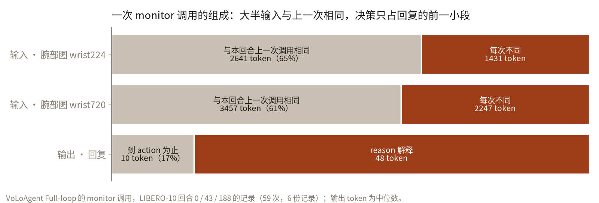
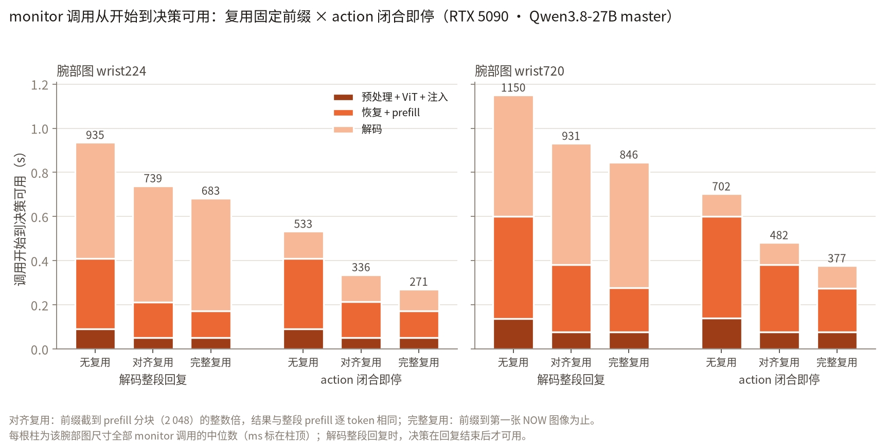
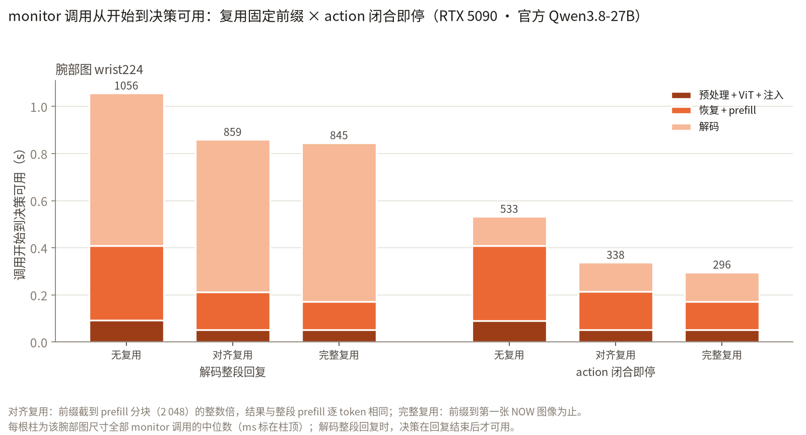

# monitor 调用：固定前缀与决策位置

问题：规划器周期性的 monitor 调用里，有多少输入每次都一样，回复里有多少 token 是执行端真正要读的；
把这两部分从关键路径上拿掉以后，从调用开始到决策可用要多久，决策会不会变。

## 结论

**Finding 1：一次 monitor 调用的输入有 61–65 % 与同一回合的其他 monitor 调用逐 token 相同。**
monitor 的提示词依次是系统提示、三张 BEFORE 图（回合第 0 步的画面）、三张 NOW 图（当前画面）、任务文本。
回合内前两部分不变：腕部图 224 时 4 072 个输入 token 里有 2 641 个（65 %），720 时 5 704 个里有 3 457 个（61 %），
其中一半的图像 token（1 349 / 2 698、2 165 / 4 330）属于 BEFORE 图。

**Finding 2：回复的决策在第 9–11 个 token 就完整了，其余约 83 % 的 token 是 `reason` 解释。**
回复格式是 `{"status":...,"action":...,"reason":...}`。master 59 次调用的回复中位 55–59 个 token，`action` 的值在第 9–11 个 token 闭合；
官方模型在冒号后加空格、有时外加 ```` ```json ```` 围栏，回复中位 70 个 token，`action` 在第 13–16 个 token 闭合。
执行端按 `action` 行动；记录里的 replan 调用的输入不含 monitor 的 `reason`。

**Finding 3：两者都拿掉以后，RTX 5090 上从调用开始到决策可用由 935 ms 降到 336 ms（master，腕部 224），
1 150 ms 降到 482 ms（master，腕部 720），1 057 ms 降到 338 ms（官方模型，腕部 224），决策与回复跟原来逐 token 相同。**
做法：回合开始时把固定前缀的状态（线性注意力的递归状态、全注意力的 FP8 KV、MTP 尾部）存成一个 capsule，
之后每次调用恢复它、只编码三张 NOW 图、只 prefill 剩下的 token；解码流按验证周期读出，`action` 的值闭合即停。
前缀截在 prefill 分块（2 048 token）的整数倍上（"对齐复用"），结果与整段 prefill 逐 token 相同（59 / 59 次回复相同）。

**Finding 4：前缀截在第一张 NOW 图（"完整复用"）再快 40–100 ms，但改变了全部 3 次非 `continue` 决策。**
不对齐的前缀边界多出一个 prefill 分块切分，数值不同：master 的 57 次 `continue` 一次没变（回复文本 55 次变了），
仅有的两次干预决策（`grasp_tool`、`next`）都变成了 `continue`；官方模型 19 次 `continue` 里 18 次不变、1 次回复变成空的 `{}`，
唯一的 `replan` 变成了 `continue`。对齐复用下两个模型合计 79 / 79 次回复不变。样本只有 3 次干预，这一条是观察，不是统计结论；
它说明近似手段的评估要单独看干预决策，平均的文本一致率看不出这种变化。







## 设置

| 项 | 取值 |
|---|---|
| 调用 | VoLoAgent Full-loop 的 monitor 调用记录：LIBERO-10 回合 0 / 43 / 188，腕部图 224 与 1280×720 各一份（`../../../wam-inference-acceleration/experiments/harness_replay_5090/calls/`，59 次 monitor 调用） |
| 规划器 | Qwen3.8-27B，FlashRT NVFP4（`Qwen36VlTorchFrontendRtx`），FP8 KV，长上下文路径，prefill 录图，官方 Qwen3.8-27B-FP8 的 MTP 头，K 取前端的长度表 |
| 模型 | LoRA 合并的 master（录制这些回复的模型，参考回复即录制的回复）；官方 Qwen3.8-27B（Thor 上的模型，参考回复为它自己的回复） |
| 硬件 | RTX 5090，独占，无执行器 |
| 每格 | 一次热身、一次计时；阶段时间为前后同步的墙钟时间 |

网格（每次调用）：

| 变量 | 取值 |
|---|---|
| 前缀 | 无复用：六张图的 ViT + 整段 prefill；对齐复用：恢复 `capsule_aligned_len(B)` = 2 048 处的 capsule，ViT 只算 NOW 图，prefill 其余 token；完整复用：capsule 截在 B（第一张 NOW 图的第一个 token） |
| 解码 | 整段回复：解码参考回复的长度（含 EOS）；action 闭合即停：同一预算，按验证周期读解码流，`action` 的值闭合的那个周期之后停止；预知长度：直接解码到 `action` 闭合所需的 token 数（"闭合即停"的下界） |
| 参照 | 图像前端的 `generate`（回放用的路径），整段回复 |

capsule 每回合由第一次 monitor 调用建一次（热身一次，计时一次）。复用时 BEFORE 图的 embedding 行留在槽位里，
相当于缓存了它们的 ViT 输出。

## 结果（RTX 5090，master）

结构（`tables.py`）：

| 腕部图 | 调用 | 输入 token | 固定前缀 B | B / 输入 | 对齐前缀 | 图像 token（固定 / 全部） | 回复 token 中位（范围） | 到 action 的 token 中位（范围） | 决策 |
|---|---|---|---|---|---|---|---|---|---|
| 224 | 30 | 4 072–4 094 | 2 641 | 65 % | 2 048 | 1 349 / 2 698 | 55（46–81） | 10（10–11） | continue 29，grasp_tool 1 |
| 720 | 29 | 5 704–5 726 | 3 457 | 61 % | 2 048 | 2 165 / 4 330 | 59（38–87） | 10（9–10） | continue 28，next 1 |

capsule：对齐 2 048 token 176 MB，建一次 235–286 ms；完整 2 641 / 3 457 token 195 / 216 MB，293–407 ms；恢复 0.32–0.42 ms。
大小主要是 48 层线性注意力的递归状态。

每格中位（ms）：

| 腕部图 | 前缀 | 解码 | 预处理 | ViT | 恢复 | prefill | 解码 | **到决策可用** | 回复相同 | action 相同 |
|---|---|---|---|---|---|---|---|---|---|---|
| 224 | generate | 整段 | 10 | 81 | – | 318 | 515 | **926** | 30/30 | 30/30 |
| 224 | 无复用 | 整段 | 10 | 81 | – | 318 | 525 | **936** | 30/30 | 30/30 |
| 224 | 无复用 | 闭合即停 | 9 | 81 | – | 318 | 123 | **532** | – | 30/30 |
| 224 | 对齐 | 整段 | 9 | 41 | 0.33 | 162 | 526 | **740** | 30/30 | 30/30 |
| 224 | 对齐 | 闭合即停 | 9 | 41 | 0.32 | 162 | 123 | **335** | – | 30/30 |
| 224 | 完整 | 整段 | 10 | 41 | 0.36 | 121 | 510 | **684** | 1/30 | 29/30 |
| 224 | 完整 | 闭合即停 | 9 | 41 | 0.37 | 121 | 99 | **273** | – | 29/30 |
| 720 | generate | 整段 | 14 | 124 | – | 462 | 550 | **1 154** | 29/29 | 29/29 |
| 720 | 无复用 | 整段 | 13 | 124 | – | 462 | 549 | **1 150** | 29/29 | 29/29 |
| 720 | 无复用 | 闭合即停 | 14 | 125 | – | 462 | 101 | **703** | – | 29/29 |
| 720 | 对齐 | 整段 | 14 | 62 | 0.33 | 305 | 549 | **931** | 29/29 | 29/29 |
| 720 | 对齐 | 闭合即停 | 13 | 62 | 0.33 | 305 | 100 | **483** | – | 29/29 |
| 720 | 完整 | 整段 | 14 | 63 | 0.42 | 199 | 570 | **848** | 1/29 | 28/29 |
| 720 | 完整 | 闭合即停 | 14 | 62 | 0.42 | 198 | 101 | **379** | – | 28/29 |

- "闭合即停"与"预知长度"相差 0–3 ms（`tables.py` 的完整表）：按验证周期读流、每周期解码一次文本的开销可以忽略。
- 注入（embedding 行 + MRoPE 行）0.8–1.2 ms，不单列。
- 同一脚本的前一版（无"闭合即停"一格）先跑过一遍，各格中位与本表相差 0–6 ms，两次干预决策在完整复用下同样变成 `continue`。

## 结果（RTX 5090，官方 Qwen3.8-27B）

回合 0 / 43，腕部 224，20 次 monitor 调用；参考回复为模型自己的回复（每次一个 160 token 预算的 `generate`，截到 EOS）。
输入与 master 相同（固定前缀 2 641 / 4 076 token），回复中位 70（54–90）个 token，到 `action` 闭合中位 13（13–16）个 token，
决策 `continue` 19 次、`replan` 1 次（ep43 第 800 步；master 在同一调用为 `continue`）。

| 前缀 | 解码 | 预处理 | ViT | 恢复 | prefill | 解码 | **到决策可用** | 回复相同 | action 相同 |
|---|---|---|---|---|---|---|---|---|---|
| generate | 整段 | 10 | 81 | – | 318 | 637 | **1 048** | 20/20 | 20/20 |
| 无复用 | 整段 | 9 | 81 | – | 318 | 647 | **1 057** | 20/20 | 20/20 |
| 无复用 | 闭合即停 | 9 | 81 | – | 318 | 123 | **533** | – | 20/20 |
| 对齐 | 整段 | 10 | 41 | 0.32 | 161 | 646 | **861** | 20/20 | 20/20 |
| 对齐 | 闭合即停 | 10 | 41 | 0.32 | 161 | 124 | **338** | – | 20/20 |
| 完整 | 整段 | 10 | 41 | 0.37 | 121 | 673 | **847** | 0/20 | 18/20 |
| 完整 | 闭合即停 | 10 | 41 | 0.36 | 121 | 124 | **297** | – | 18/20 |

完整复用下的两次 action 变化：ep43 第 800 步 `replan` → `continue`；ep43 第 560 步回复为 `{}`（无 action）。

## 对 Thor 的含义（推算，待 H8 实测）

Thor 上官方模型的 monitor 调用（`THOR_STATUS_SUMMARY.md` `1105_h6h4` 轮，20 次，腕部 224）：ViT 270 ms、prefill 3 986 ms、
解码 2 228 ms（每周期 85.9 ms）、整次 6 506 ms，超过 monitor 间隔 5.33 s。Thor 的 prefill 约 0.98 ms / token、
占整次 61 %（5090 为 34 %），所以前缀复用在 Thor 上省得更多。按每 token 的 prefill 不变、"闭合即停"约 5 个周期推算：
对齐复用 + 闭合即停约 0.14 + 2.0 + 0.43 ≈ 2.6 s，低于 5.33 s。这是推算；实测见 `THOR_CHECKLIST.md` H8。

## 范围与限制

- 画面来自 LIBERO 数据集的成功演示，所以决策几乎都是 `continue`；两个模型合计干预决策只有 3 次。
  决策位置（第 9–11 个 token）由回复格式决定，与决策取值无关。
- "闭合即停"不生成 `reason`。harness 若要记录解释，可以在执行端拿到决策之后再继续解码，放在关键路径之外；本实验没有测这一做法。
- 只测规划器单独运行；与执行器共置时的数字见 `harness_replay_5090/README.md`。

## 文件

| 文件 | 内容 |
|---|---|
| `monitor_call_bench.py` | 网格：前缀 × 解码，`{rtx|thor}` 前端，`{recorded|own}` 参考回复 |
| `run_master.sh` / `run_official.sh` | RTX 5090 上的两组运行 |
| `tables.py` | 结构、capsule、各格中位的表（无绘图依赖） |
| `figures.py` | 两张图 |
| `monitor_call_rtx_master.json` / `.log` | master 结果 |
| `monitor_call_rtx_official.json` / `.log` | 官方模型结果 |
